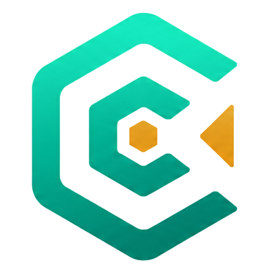
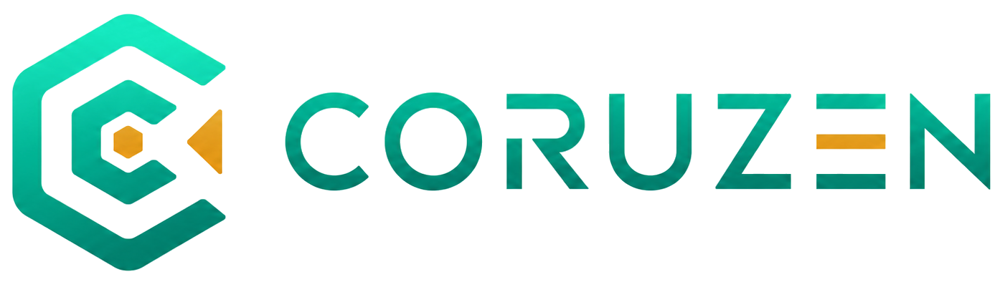

<div align="center">



# Jucélio Verissimo

### Founder @ CORUZEN · Full-Stack Software Engineer

**Turning complex business operations into secure, scalable software.**

`Enterprise Software` · `Cybersecurity` · `SaaS` · `Automation` · `Mobile` · `PWA`

**4 Production Systems** &nbsp;·&nbsp; **20+ Businesses Served** &nbsp;·&nbsp; **24/7 Operations** &nbsp;·&nbsp; **99.9% Availability**

<sub><strong>Secure by design · Built for production · Engineered to scale</strong></sub>

</div>

---

## About

I am a **Full-Stack Software Engineer and Founder of CORUZEN**, focused on designing and building software that supports real business operations — from the user interface to the infrastructure running in production.

My work spans **frontend engineering, backend development, APIs, databases, system architecture, cybersecurity, integrations, automation, mobile solutions, Android-focused applications, and Progressive Web Apps (PWAs)**.

At CORUZEN, we build technology for organizations across **manufacturing, retail and commercial operations, warehousing, inventory management, logistics, events, data security, service businesses, and enterprise operations**.

> **The goal is not simply to ship features. It is to engineer software that organizations can rely on.**

---

## What I Build

| Product & Software Engineering | Platform & Systems Engineering |
|---|---|
| Full-stack web applications | APIs and backend services |
| Enterprise software | Authentication and authorization |
| Industrial and operational systems | Multi-tenant platforms |
| SaaS products | Data modeling and databases |
| Mobile and Android-focused solutions | Integrations and webhooks |
| Progressive Web Apps | Background jobs and workers |
| Dashboards and business interfaces | Observability and auditability |
| Responsive design systems | Cloud and production infrastructure |

---

## Engineering at CORUZEN

Across CORUZEN projects, technology choices vary by product requirements, but the engineering principles remain consistent.

### Architecture

We favor **modular architectures with clear domain boundaries**, strong separation of concerns, and infrastructure that can evolve without unnecessary operational complexity.

`Modular Monoliths` · `Domain Boundaries` · `Strong Typing` · `Provider Abstractions` · `Event-Driven Jobs`

### Security

Security is treated as an architectural requirement rather than a final checklist.

`Server-Side Authorization` · `RBAC` · `RLS` · `Least Privilege` · `CSP` · `Rate Limiting` · `Encryption` · `Audit Logs`

### Data & Reliability

Business-critical state is designed around consistency, traceability, and predictable failure handling.

`PostgreSQL` · `Transactions` · `Constraints` · `Migrations` · `Idempotency` · `Reconciliation` · `Structured Logging`

### Offline & Field Operations

When connectivity is unreliable, selected systems are designed around **installable PWA experiences, local persistence, controlled synchronization, and offline-safe operational workflows**.

`Service Workers` · `IndexedDB` · `Offline-First PWA` · `Sync Engines` · `Conflict Handling`

### DevSecOps & Quality

Production readiness includes more than a successful build.

`Type Safety` · `Validation` · `Unit Tests` · `Integration Tests` · `E2E` · `CI/CD` · `Security Audits` · `Observability`

---

## Production Systems

CORUZEN currently operates **four production systems**, each addressing a different business challenge while following the same standards for reliability, security, usability, and maintainability.

### CORUZEN Security

**Cybersecurity & Security Posture**

A cybersecurity platform for evaluating the public-facing security posture of web environments through **safe, non-invasive assessment methods**.

**Focus:** security visibility · risk prioritization · actionable reporting · web security

> Turning technical security signals into clear information for better decisions.

---

### CORUZEN Tickets

**Event Ticketing & Operational Management**

A platform designed to support the event lifecycle from **registration and ticketing to attendee management and digital check-in**.

**Focus:** ticketing · registrations · event operations · attendee workflows · digital access

> Connecting the commercial and operational sides of events in one reliable workflow.

---

### PALETIN

**Inventory Verification & Stock Operations**

An operational system designed for **inventory counting, stock verification, barcode-driven workflows, and connected business processes**.

**Focus:** inventory accuracy · barcode operations · stock control · field mobility · business integrations

> Built for environments where speed, traceability, and inventory accuracy directly affect operations.

---

### FRIAXIS

**Enterprise Android Device Management**

A platform for organizations that require centralized management of **business-critical Android devices and controlled operational environments**.

**Focus:** enterprise mobility · managed Android devices · kiosk environments · policy enforcement · device administration

> Supporting secure and reliable device operations across distributed business environments.

---

### One Engineering Standard. Different Business Challenges.

`Security by Design` · `Operational Reliability` · `Scalability` · `Auditability` · `Automation` · `Business Continuity`

Public descriptions intentionally focus on **business capabilities and engineering outcomes**. Internal architecture, customer-specific workflows, security controls, credentials, and proprietary implementation details remain private.

---

## Technology Landscape

<sub>Selected technologies used across CORUZEN projects depending on product requirements.</sub>

### Frontend


`Responsive UI` · `Design Systems` · `Accessibility` · `Mobile-First` · `PWA`

### Backend & Data


`REST APIs` · `PostGIS` · `RBAC` · `RLS` · `Webhooks` · `Background Jobs` · `Data Modeling`

### Cloud, Integrations & Operations


`Neon` · `Cloudflare R2 / S3` · `BullMQ` · `Resend` · `Mercado Pago` · `OAuth` · `CI/CD`

### Mobile, PWA & Offline

`Android` · `Progressive Web Apps` · `Service Workers` · `IndexedDB` · `Offline Sync` · `Cross-Device Operations`

### Testing & Engineering Quality

`Vitest` · `Playwright` · `ESLint` · `TypeScript Strict` · `Zod` · `Security Auditing` · `Migration Validation`

---

## Engineering Principles

```text
Business Requirement
        ↓
Product & Domain Architecture
        ↓
Frontend + Backend + Data
        ↓
Security + Authorization
        ↓
Integrations + Automation
        ↓
Testing + Observability
        ↓
Reliable Production Operations
        ↓
Continuous Improvement & Scale
```

I approach software as a complete engineering system — balancing **business value, user experience, security, performance, maintainability, cost, and operational reliability**.

---

## Industries & Business Environments

We build software for organizations operating across different sectors and operational realities:

`Manufacturing` · `Retail & Commerce` · `Warehousing` · `Inventory` · `Logistics` · `Events` · `Data Security` · `Service Providers` · `Enterprise Operations`

The common denominator is the same: **software must support real workflows, real users, and real operational constraints.**

---

## Private by Design

Most production repositories are private because they contain **proprietary business logic, customer-specific implementations, infrastructure, integrations, operational workflows, and security controls**.

Public repositories are reserved for selected documentation, architecture, reusable components, technical demonstrations, and open-source initiatives.

---

<div align="center">



### Secure Engineering. Scalable Systems. Real Business Impact.

**Cybersecurity · Full-Stack Engineering · Enterprise Software · SaaS · Automation · Mobile · PWA**

</div>
